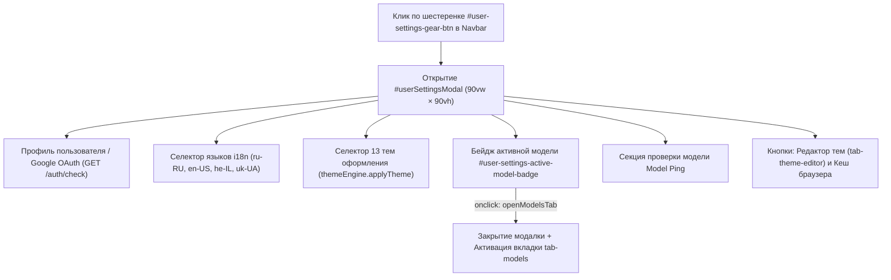

# ⚙️ Навык: Агент синхронизации и аудита единого модального окна настроек (User Settings Sync Agent)

## 📌 Назначение и концепция

Единое модальное окно настроек пользователя (`#userSettingsModal`) — ключевой системный компонент интерфейса во всей экосистеме проектов:
1. **AI-Assistant** (`%localappdata%\AI-Assistant\apps\common\webgui`)
2. **AI-TC** (`%localappdata%\AI-TC\apps\common\webgui`)
3. **AI-Breadboard** (`%localappdata%\AI-Breadboard\apps\common\webgui`)

Базовые архитектурные принципы и правила построения единого окна зафиксированы в мастер-диалоге:
🔗 [conversation 5bda405e-140b-4205-b1af-3020aea81e71](conversation://5bda405e-140b-4205-b1af-3020aea81e71).

Главная цель данного агента — **исключить дублирование сущностей**, автоматически отслеживать изменения логики в коде любого из проектов, выполнять проверку обратной и взаимной совместимости (контракты DOM, темы, локали, эндпоинты) и каскадно распространять корректные изменения на все проекты.

---

## 🏗️ Архитектурные принципы окна настроек



### 1. Единый источник истины (Single Source of Truth)
Все общие элементы модального окна хранятся строго в `apps/common/webgui/`:
- **Разметка**: `apps/common/webgui/components/user_settings_modal.html`
- **Клиентский контроллер**: `apps/common/webgui/js/userSettings.js`
- **Темы оформления**: `apps/common/webgui/themes/` (каталог из 13 тем)
- **Стили**: `apps/common/webgui/css/components.css`, `base.css`, `themes.css`
- **Словари локализации**: `apps/common/webgui/locales/{ru,en,he,uk}.json`

### 2. Геометрический стандарт (90% экрана)
Согласно стандарту `WEBGUI.md § 5.4`, модальное окно жестко зафиксировано на **90% экрана**:
```css
.modal .modal-dialog {
  --bs-modal-width: var(--modal-width, 90vw) !important;
  width: var(--modal-width, 90vw) !important;
  max-width: var(--modal-width, 90vw) !important;
  height: var(--modal-height, 90vh) !important;
  max-height: var(--modal-height, 90vh) !important;
  min-height: var(--modal-height, 90vh) !important;
  margin: calc((100vh - var(--modal-height, 90vh)) / 2) auto !important;
}
```

### 3. Интеграция выбора модели ИИ и бейджа
- В шапке окна (`#user-settings-active-model-badge-top`) и в секции проверки модели (`#user-settings-active-model-badge`) размещен интерактивный бейдж.
- Бейдж отображает имя текущей активной модели (опрашивая `/api/v1/chat/active-model` или `/auth/settings`).
- При событии `onclick` (или клике на бейдж) вызывается функция `openModelsTab()`, которая:
  1. Корректно закрывает инстанс `#userSettingsModal`;
  2. Переключает интерфейс на унифицированную вкладку каталога моделей `tab-models` через `window.switchTab('tab-models')`.

### 4. Полнота каталога тем оформления
Селектор `#modal-theme-selector` обязан содержать все темы системы с группировкой:
- **Системная**: `system`
- **🌙 Тёмные темы**: `dark`, `theme-dark-slate`, `theme-cyberpunk`, `terminal`, `nordic-frost`, `solarized-dark`, `theme-high-contrast`
- **☀️ Светлые темы**: `light`, `nightview` (Тёплая бумага), `nightview-70` (Тёплая бумага 70%), `brick`, `theme-light-enterprise`

---

## 🛠️ Инструментарий агента

Навык включает в себя два исполняемых скрипта в папке `scripts/`:

### 1. `verify_modal_integrity.py`
Выполняет неразрушающий аудит всех проектов:
- Проверяет наличие всех 14 обязательных DOM ID;
- Проверяет селектор всех 13 тем и 4 языков;
- Проверяет экспорт функций `openModelsTab`, `refreshActiveModelBadge`, `initUserSettings`;
- Проверяет целостность локалей и кросс-проектное соответствие байт-в-байт.

**Запуск:**
```powershell
py .agents/skills/user-settings-sync-agent/scripts/verify_modal_integrity.py
# или через универсальный CLI:
py manage_tools.py ui check-user-settings
```

### 2. `sync_user_settings.py`
Выполняет интеллектуальную синхронизацию:
- Выполняет глубокое рекурсивное слияние словарей локалей `ru`, `en`, `he`, `uk` (предотвращает затирание проектных ключей, таких как `admin`, `systemControl`, `wikillm`);
- Копирует `user_settings_modal.html` и `userSettings.js` во все 3 проекта;
- Актуализирует статическую разметку модального окна в `index.html` и `admin/index.html`;
- Автоматически запускает валидационный аудит после завершения синхронизации.

**Запуск:**
```powershell
py .agents/skills/user-settings-sync-agent/scripts/sync_user_settings.py
# или через универсальный CLI:
py manage_tools.py ui sync-user-settings
```

---

## 📋 Протокол действий агента при изменении кода

Если поступает задача на изменение логики окна настроек, добавление новой темы, изменение работы с моделью или профилем:

1. **Анализ затронутых файлов**:
   - Относится ли изменение к `#userSettingsModal`, `userSettings.js`, темам или локалям?
2. **Внесение изменений в `apps/common/webgui/`**:
   - Изменения вносятся в эталонные файлы `apps/common/webgui/components/user_settings_modal.html` или `apps/common/webgui/js/userSettings.js`.
3. **Обновление заголовков файлов**:
   - В шапке каждого измененного файла фиксируется метка времени: `Updated: YYYY-MM-DD HH:MM:SS`.
4. **Запуск синхронизации**:
   ```powershell
   py .agents/skills/user-settings-sync-agent/scripts/sync_user_settings.py
   ```
5. **Верификация тестами**:
   ```powershell
   pytest tests/test_theme_editor_inheritance.py tests/test_table_resizers.py
   ```
6. **Контрольный чек-лист**:
   - [ ] Контракт геометрии `90vw × 90vh` не нарушен.
   - [ ] Бейдж активной модели присутствует и открывает `tab-models`.
   - [ ] В селекторе присутствуют все темы (включая `nightview-70`).
   - [ ] Все локали содержат ключ `activeModelBadgeTitle`.
   - [ ] Все 3 проекта (`AI-Assistant`, `AI-TC`, `AI-Breadboard`) синхронизированы.
