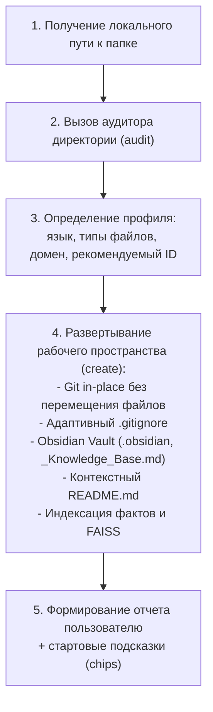

<!--
=============================================================================
Process Name: Agent Skill - Workspace Creator
=============================================================================
Description:
  Инженерный навык для ИИ-моделей по созданию полноценного рабочего пространства
  на базе указанной локальной директории (In-Place Grounding).
  Обеспечивает автономный аудит файлов, языков, развёртывание Git на месте,
  Obsidian Vault, адаптивный .gitignore и стартовую индексацию базы знаний.

File: SKILL.md
Package: .agents/skills/workspace-creator
Author: hypo69
Copyright: © 2026 hypo69
Updated: 2026-11-10 16:55:00
=============================================================================
-->

# 🛠️ Навык: Создатель рабочего пространства (Workspace Creator)

Этот навык обучает и направляет ИИ-модель при создании нового рабочего пространства в **AI-Assistant** на основе **локальной директории на диске**.

Вместо примитивного создания пустой папки через текстовые формы, модель использует данный навык как **интеллектуальный мастер (Wizard)**: анализирует файлы директории, определяет их назначение и язык, инициализирует Git-репозиторий на месте (без перемещения файлов) и разворачивает всю инфраструктуру базы знаний.

---

## 🎯 Когда активировать навык

Активируйте этот навык всякий раз, когда:
- Пользователь просит создать новое рабочее пространство («Создай область для папки X», «Подключи каталог C:/... как workspace»).
- Пользователь указывает локальную директорию на диске для версионирования или индексации.
- В интерфейсе вызывается мастер создания рабочей области с привязкой к локальному пути.

---

## 📋 Инженерный протокол модели (Пошаговые действия)



### Шаг 1: Получение и валидация локального пути
Убедитесь, что передан существующий локальный путь (например, `C:/Users/onela/Desktop/דוד מושה` или `/data/workspaces/...`). Если путь не указан, запросите его у пользователя.

### Шаг 2: Аудит локальной папки
Запустите команду аудита через встроенный скрипт навыка:
```powershell
py .agents/skills/workspace-creator/scripts/workspace_creator_cli.py audit "<LOCAL_DIRECTORY_PATH>" --json
```
Или вызовите движок напрямую в Python:
```python
from apps.ai_assistant.core.workspace_creator_engine import WorkspaceCreatorEngine
from apps.ai_assistant.core.workspace_manager import WorkspaceManager

engine = WorkspaceCreatorEngine(WorkspaceManager())
profile = engine.audit_directory("<LOCAL_DIRECTORY_PATH>")
```

Аудитор возвращает:
- `total_files` — количество обнаруженных файлов;
- `extensions` — частотный словарь расширений (`.txt`, `.pdf`, `.docx`, `.py` и др.);
- `detected_language` — основной язык текстов (`ru`, `he`, `en`, `ua`);
- `suggested_id` — безопасный уникальный идентификатор;
- `suggested_name` — понятное имя рабочей области;
- `suggested_description` — семантическое описание назначения файлов;
- `qualified_path` — переносимый UNC-путь с именем компьютера (`\\<HOST>\<PATH>`).

### Шаг 3: Согласование или подтверждение параметров
Если модель ведёт интерактивный диалог, она может кратко подтвердить с пользователем:
- Имя рабочей области;
- Язык (`ru`, `he`, `en`, `ua`).

В автономном режиме модель использует рекомендованные аудитором параметры.

### Шаг 4: Развертывание рабочего пространства
Выполните создание рабочего пространства:
```powershell
py .agents/skills/workspace-creator/scripts/workspace_creator_cli.py create "<LOCAL_DIRECTORY_PATH>" --id "<ID>" --name "<NAME>" --lang "<LANG>" --json
```

Что происходит автоматически на этом этапе:
1. **Регистрация в WorkspaceRegistry:** Фиксация привязки к `\\<HOST>\<PATH>` в `.workspace/config.json`.
2. **Git на месте (In-Place Tracking):** Исходные файлы остаются в своей родной папке (`copy_to_workspace = false`).
3. **Адаптивный `.gitignore`:** Исключаются системные Thumbs.db, Desktop.ini, lock-файлы Word `~$*`, кэши и внутренняя БД.
4. **Obsidian Vault:** Создаются `.obsidian/app.json`, сводная база знаний `_Knowledge_Base.md`, единый манифест `.workspace/manifest.json`. Все сопутствующие теневые файлы получают префикс точки (`.<name>.md`) через `ServiceFileAuthenticator`.
5. **Контекстный `README.md`:** Создаётся файл с описанием назначения и состава папки на целевом языке.
6. **Индексация знаний и FAISS:** Извлекаются сущности, факты, строятся векторные эмбеддинги.
7. **Prompt Chips:** Генерируются контекстные вопросы для старта работы.

### Шаг 5: Итоговый отчёт пользователю
Предоставьте пользователю структурированную сводку:
- Название и идентификатор пространства;
- Количество подключенных файлов и доминирующий язык;
- Статус Git-фиксации;
- 3–4 стартовых вопроса (chips) для быстрого диалога с базой знаний этой папки.

---

## 🛠️ Внутренние компоненты

- **CLI-утилита:** [`.agents/skills/workspace-creator/scripts/workspace_creator_cli.py`](file:///c:/Users/onela/AppData/Local/AI-Assistant/.agents/skills/workspace-creator/scripts/workspace_creator_cli.py)
- **Базовый движок:** [`apps/ai_assistant/core/workspace_creator_engine.py`](file:///c:/Users/onela/AppData/Local/AI-Assistant/apps/ai_assistant/core/workspace_creator_engine.py)
- **Классификатор служебных файлов:** [`apps/ai_assistant/core/service_file_authenticator.py`](file:///c:/Users/onela/AppData/Local/AI-Assistant/apps/ai_assistant/core/service_file_authenticator.py)
