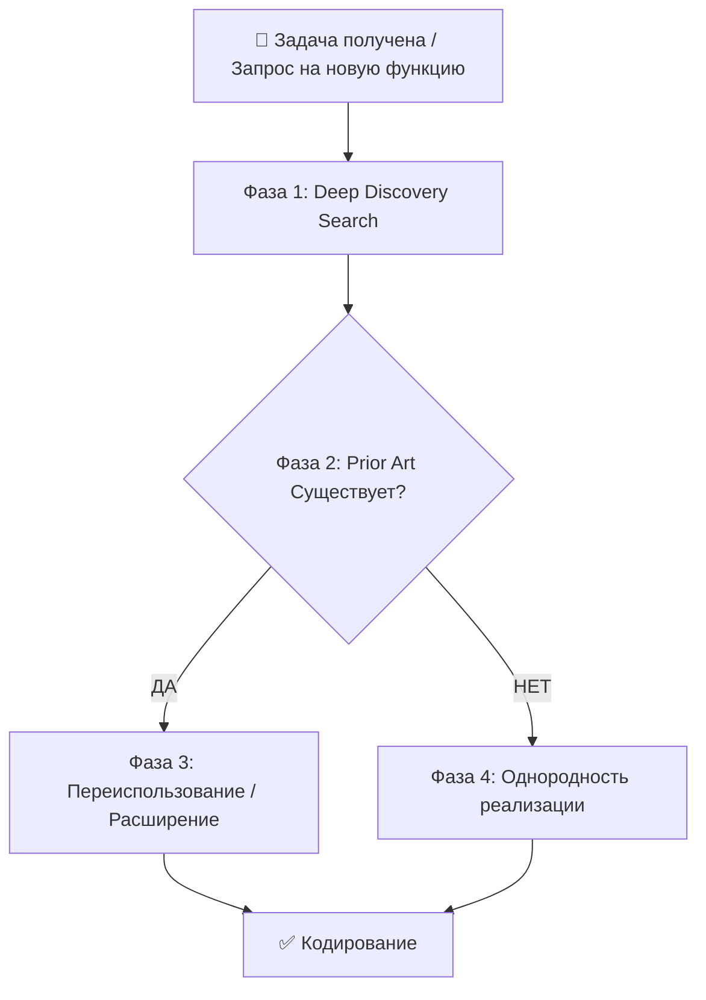

# ♻️ Стандарт переиспользования кода (Zero Divergence Protocol) v1.2

**Статус:** ✅ Production Ready  
**Версия:** 1.2 (AI-Assistant Edition)  
**Принцип:** Zero Divergent Implementations  
**Автор:** hypo69  
**Copyright:** © 2026 hypo69  
**Updated:** 2026-11-01 17:30:00

---

## 📋 Содержание
1. [Фундаментальный принцип](#1-фундаментальный-принцип)
2. [4-фазный протокол аудита](#2-4-фазный-протокол-аудита)
3. [Правила и запреты](#3-правила-и-запреты)
4. [Матрица решений](#4-матрица-решений)
5. [Чек-лист перед кодированием](#5-чек-лист-перед-кодированием)

---

## 1. Фундаментальный принцип

> **MANDATORY RULE:**  
> **Перед созданием любой новой функциональности, UI-компонента, функции, класса, утилиты или API-эндпоинта, AI-ассистент MUST выполнить аудит существующей кодовой базы (Prior Art Audit), чтобы проверить — существует ли уже эта функциональность или эквивалентный паттерн.**
>
> **НИКОГДА не создавайте дублирующую или конфликтующую реализацию для функциональности, которая уже имеет готовый модуль в проекте.**

---

## 2. 4-фазный протокол аудита

Этот протокол **MUST** выполняться в строгом порядке перед любым кодированием:



### Фаза 1: Deep Discovery Search

**Задача:** Найти все существующие реализации похожей функциональности в реальной структуре проекта **AI-Assistant**:

```text
apps/
  ai_assistant/            ← Основное приложение умного помощника и истории файлов
    core/                  ← Ядро бизнес-логики (ОБЯЗАТЕЛЬНО проверять перед созданием новых сервисов):
      workspace_manager.py       ← Управление рабочими областями, синхронизация и детекция изменений
      workspace_registry.py      ← Реестр .workspace/config.json и привязка путей к имени ПК (USB-portable)
      workspace_items_tracker.py ← Git-слежение за файлами и папками на месте (без копирования)
      workspace_file_ops.py      ← Операции с файлами и папками внутри рабочей области
      workspace_relocator.py     ← Перемещение и релокация рабочих пространств
      git_history_engine.py      ← История коммитов, диффы, ревизии, откаты Git
      git_maintenance.py         ← Обслуживание Git-репозиториев (gc, fsck, упаковка объектов)
      ai_diff_summarizer.py      ← ИИ-резюмирование изменений между версиями файлов
      wikillm_version_linker.py  ← Семантическая привязка версий и коммитов к статьям WikiLLM
      knowledge_store.py         ← SQLite хранилище знаний (WAL): документы, факты, сущности, связи
      store/                     ← Репозитории таблиц БД (document_fact_repo, workspace_repo, telemetry_repo, schema)
      rag_faiss_engine.py        ← Гибридный семантический + лексический поиск (FAISS + TF)
      qa_engine.py               ← Вопросно-ответный движок по фактам, FAISS и WikiLLM
      obsidian_vault.py          ← Генератор и обогатитель заметок Obsidian Vault (_Knowledge_Base.md, _Topics/)
      content_extractor.py       ← Универсальное извлечение текста из PDF, DOCX, Excel, CSV, Аудио, Google Sheets
      doc_categorizer.py         ← Автоматическая категоризация документов
      nlp_analyzers.py & nlp/    ← Мультиязычное извлечение фактов и парсинг интентов (ru, he, en)
      gmail_manager.py           ← Интеграция с Gmail API и индексация писем (gmail_rag_service.py)
    api/
      routers/             ← FastAPI роутеры (/api/v1/...)
      webgui/              ← Веб-интерфейс приложения и модули вкладок tab_<tab_id>/
  common/                  ← Общие переиспользуемые модули для веб-приложений:
    file_editor/           ← Редактор файлов (включая Rust/WASM движок)
    file_tree/             ← Проводник и дерево файлов
    obsidian/              ← Общий роутер и интеграция Obsidian
    webgui/                ← Общие компоненты UI, темы (themes/), стили (css/), скрипты (js/), ai_modal_dialog/
  pdf_wasm_converter/      ← Конвертер PDF на базе Rust/WASM

src/
  ai/                      ← Единый слой ИИ: UnifiedChatModel, провайдеры (gemini, agy, ollama, openai, hf, foundry, onnx), оркестрация, RAG, агенты
  skills/                  ← Реестр и загрузчик навыков
  secrets/                 ← Управление секретами, OAuth-токенами Google и почтовыми ящиками (mailboxes.json)
  utils/                   ← Общие утилиты: jjson.py, file.py, archive.py, pdf.py, docx.py, smtp.py и пакет конвертеров convertors/
```

### Фаза 2: Сравнение и анализ коллизий

Задайте 4 контрольных вопроса:
1. **Функциональное перекрытие на 80%+?** Если существующий модуль решает 80% запроса — переиспользуйте его.
2. **Есть ли установленная сигнатура API, структура данных или паттерн?** Следуйте ему, не изобретайте новый.
3. **Создам ли я два разных способа делать одно и то же?** Если да — выберите один общий способ.
4. **Есть ли эквивалентный компонент в `apps/common/` или `src/utils/`?** Всегда проверяйте общие пакеты перед написанием локального хелпера.

### Фаза 3: Матрица решений

- **Правило A (Прямое переиспользование):** Если компонент или функция уже решает задачу — импортируйте и используйте её.
- **Правило B (Расширение):** Если существующий модуль покрывает часть требования — расширьте его новым опциональным параметром или методом.
- **Правило C (Однородная реализация):** Если аналогов нет — создайте новый модуль в профильной директории по стандартам [`ENGINEERING.md`](ENGINEERING.md) и [`DOCUMENTATION.md`](DOCUMENTATION.md).

### Фаза 4: Верификация однородности

Проверьте:
- [ ] Решение не фрагментирует архитектуру.
- [ ] Публичные интерфейсы остаются однородными.
- [ ] Нет локальных дубликатов функций, которые уже есть в `src/utils/` или `apps/common/`.

---

## 3. Правила и запреты

| Область | ❌ Запрещено (MUST NOT) | ✅ Требуется (MUST) |
|---------|---|---|
| **UI Компоненты и Модалки** | Создавать кастомные модальные окна со своими размерами или дублировать `AIModalDialog`. | Использовать единый стандарт модальных окон (`90vw × 90vh` в `components.css`) и глобальный синглтон `window.AIModalDialog`. |
| **Меню субпанелей и блоков** | Верстать разнородные переключатели, аккордеоны или генерировать тултипы через модель на лету. | Строить двухуровневые меню по стандарту [`SUBTABS_AND_BLOCKS_MENU.md`](SUBTABS_AND_BLOCKS_MENU.md) с `menu_config.json` и статическими i18n-тултипами. |
| **История файлов и Git** | Вызывать разрозненные shell-команды `git` напрямую из роутеров или плодить копии файлов. | Использовать `GitHistoryEngine`, `WorkspaceItemsTracker`, `WorkspaceManager` и `GitMaintenanceService` в `apps/ai_assistant/core/`. |
| **Извлечение текста и конвертация** | Писать локальные парсеры PDF/Excel/DOCX/Audio внутри роутеров. | Использовать `content_extractor.py` и конвертеры из `src/utils/convertors/`. |
| **База знаний и поиск** | Выполнять несогласованные прямые SQL-запросы к таблицам знаний в обход репозиториев. | Использовать `KnowledgeStore`, репозитории в `apps/ai_assistant/core/store/` и `RagFaissEngine`. |
| **Файловые и JSON операции** | Писать дублирующие обертки чтения/записи JSON. | Использовать `src/utils/jjson.py` (`j_loads`, `j_dumps`) и `src/utils/file.py`. |
| **AI клиенты** | Прямые разрозненные вызовы SDK провайдеров в бизнес-логике. | Выполнять запросы через `UnifiedChatModel` и оркестратор `src/ai/`. |
| **Логирование** | Использовать `print()` или собственные логгеры. | Использовать `from logger import logger` (и `logger.console()` для консоли). |
| **Конфигурация** | Хардкодить порты, пути, URL или тексты интерфейса. | Считывать параметры из `config.json` / `.env`, а строки UI — из словарей `locales/*.json`. |

---

## 4. Чек-лист перед кодированием

- [ ] **Prior Art Search выполнен:** Проверены `apps/ai_assistant/core/`, `apps/common/`, `src/ai/`, `src/utils/`.
- [ ] **No Divergent Duplication:** Подтверждено отсутствие параллельной реализации.
- [ ] **Shared Utilities используются:** Переиспользованы существующие конвертеры, репозитории и UI-компоненты.
- [ ] **Uniform Style:** Соблюдены все правила из [`ENGINEERING.md`](ENGINEERING.md) и [`WEBGUI.md`](WEBGUI.md).
- [ ] **Documentation готова:** Обновлены `README.md`, docstrings и временная метка `Updated:` в шапке файла.
