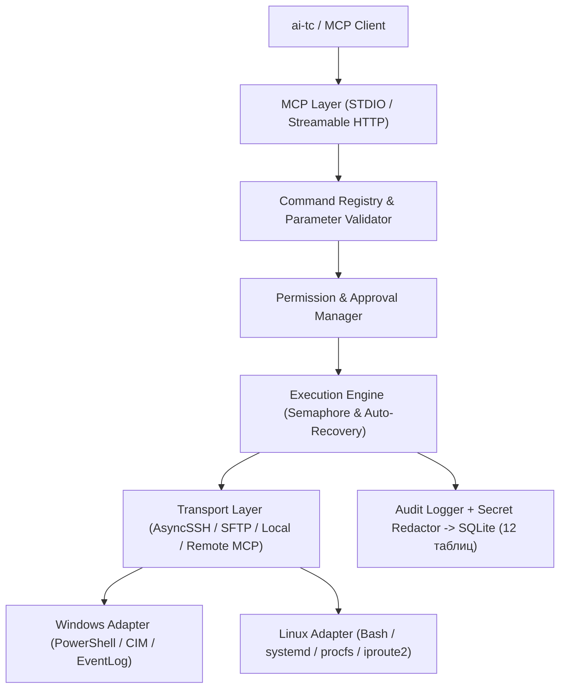

# 🔌 SSH MCP Server (Hybrid Windows + Linux Full Admin)

**Описание:** Универсальная система удалённого и локального администрирования Windows и Linux, предоставляющая AI-агентам стандартизированный интерфейс Model Context Protocol (MCP SDK v2) с централизованным реестром команд (`CommandRegistry`), контролем подтверждений (`ApprovalManager`) и полным аудитом.

## 🏛️ Архитектура (3 компонента и 3 уровня)

1. **`ssh-mcp-core`** (`core/`, `security/`, `storage/`, `transports/`, `platforms/`):
   - Независимое ядро управления подключениями, проверки прав, секретов и выполнения команд.
2. **`ssh-mcp-server`** (`server.py`, `mcp_tools/`, `main.py`):
   - Интерфейс MCP v2 (`STDIO` и `Streamable HTTP`), экспортирующий 10 функциональных модулей (72 инструмента).
3. **`ssh-mcp-agent`** (`server.py` в режиме `remote`):
   - Удалённый агент для Windows Service / Linux `systemd`, предоставляющий защищённый TLS + Bearer + Origin интерфейс.



## 🚀 Быстрый запуск

```powershell
# Локальный режим STDIO (для ai-tc, Antigravity, Claude Desktop, Cursor)
python -m ssh_mcp

# Удалённый режим Streamable HTTP
$env:SSH_MCP_API_TOKEN = "your-strong-secret-token"
python -m ssh_mcp --transport streamable-http --host 127.0.0.1 --port 8765
```

## 📂 Структура пакета

- `config/` — `settings.yaml` и `hosts.yaml`
- `core/` — `ConnectionManager`, `CommandRegistry`, `ExecutionEngine`, `TaskManager`, `PermissionManager`, `ApprovalManager`, `ResultNormalizer`
- `transports/` — `AsyncSSHTransport`, `SFTPFileManager`, `LocalTransport`, `RemoteMCPTransport`
- `platforms/` — доменные адаптеры `windows/` и `linux/`
- `mcp_tools/` — 10 групп инструментов MCP
- `security/` — `CredentialManager`, `HostKeyVerifier`, `RemoteMCPAuthenticator`, `PathPolicyValidator`, `SecretRedactor`, `AuditLogger`
- `storage/` — `DatabaseManager` и 12 изолированных репозиториев таблиц
- `registry/` — каталоги команд `windows.yaml`, `linux.yaml` и политики `default.yaml`, `admin.yaml`
- `tests/` — модульные, интеграционные и security-тесты

**Updated:** 2026-10-31 17:04:30
