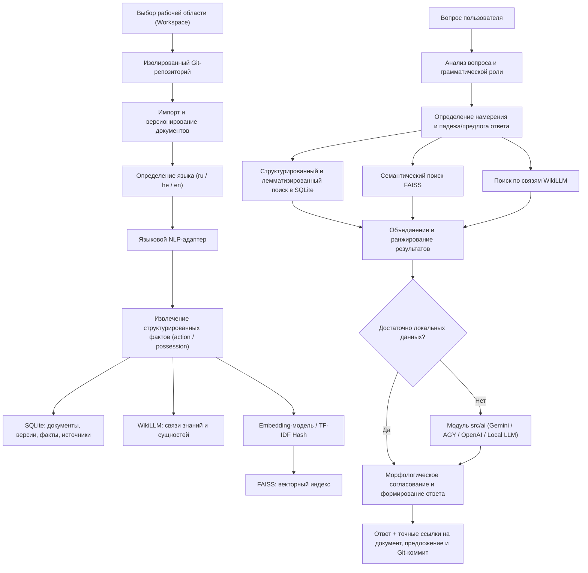

# Техническое задание: Разработка мультиязычной системы извлечения знаний и интеллектуального поиска на базе Python, Git, RAG, WikiLLM, FAISS, SQLite и модулей ИИ (`src/ai`)

**Тип документа:** техническое задание на разработку программного обеспечения  
**Статус:** утверждённое техническое задание  
**Заказчик:** AI-BreadBoard  
**Пакет реализации:** `apps.ai_assistant`  
**Основной язык разработки:** Python 3.12+  
**Целевая платформа:** Windows, с возможностью последующего переноса на другие ОС  
**Принцип реализации:** Local-first, носимый режим (USB-portable с привязкой внешних путей к имени компьютера `\\<HOST_NAME>\<PATH>`), слежение Git за файлами на месте без копирования (`copy_to_workspace = False`), модульная архитектура, независимость от конкретного поставщика языковых моделей (интеграция через `src/ai`).  
**Updated:** 2026-10-26 00:35:00  

---

## 1. Назначение системы

Разработать мультиязычную систему управления рабочими областями документов (с индивидуальным Git-репозиторием для каждой рабочей области), обработки файлов, извлечения структурированных знаний, поиска фактов и грамматически точного формирования ответов на естественном языке.

Система должна поддерживать обработку текстов на разных языках (в первой очереди — русский язык и иврит, с расширяемой архитектурой для английского и других языков), используя лёгкие локальные языковые компоненты, специализированные морфолого-синтаксические анализаторы и, при необходимости, облачные и локальные языковые модели из единого модуля `src/ai` (Gemini, AGY, OpenAI, Ollama, Foundry).

В качестве основных технологий используются:

- **Python** — оркестрация и бизнес-логика;
- **Git (по рабочим областям)** — отслеживание истории изменений каждого документа, фиксация ревизий и контроль актуальности фактов;
- **NLP-анализаторы** — морфологический и синтаксический разбор текста, лемматизация и склонение словоформ для ответа;
- **RAG (Retrieval-Augmented Generation)** — поиск контекста для формирования ответов;
- **WikiLLM** — организация и обогащение связей между знаниями;
- **FAISS** — векторный индекс для семантического поиска;
- **SQL-хранилище (SQLite)** — структурированные факты, документы, версии, метаданные и связи;
- **Модуль `src/ai` (Gemini API, AGY, OpenAI и др.)** — дополнительный облачный/локальный анализатор и генератор ответов.

---

## 2. Основные цели

1. Обеспечить выбор и изоляцию рабочих областей (Workspaces), где каждая рабочая область отслеживается собственным репозиторием Git.
2. Обеспечить поиск фактов независимо от конкретной формулировки вопроса (активный/пассивный залог, перефразирование, вопросы о принадлежности).
3. Обеспечить корректную обработку морфологии и синтаксиса разных языков (русский, иврит и др.).
4. Находить связи между субъектами, действиями, объектами, владельцами и принадлежащими сущностями.
5. Объединять результаты локального и облачного анализа в единую систему знаний.
6. Сохранять связь каждого извлечённого факта с исходным документом, предложением и ревизией Git.
7. Минимизировать использование облачных API без существенного снижения качества (принцип Local-first).
8. Обеспечить возможность добавления новых языков без переработки ядра системы.
9. Предоставить измеримые показатели качества, скорости, потребления памяти и стоимости обработки.

---

## 3. Функциональные требования

### 3.1. Управление рабочими областями, слежение Git без копирования и носимый режим (USB)

Система должна поддерживать:

- создание и выбор рабочих областей (каждая рабочая область имеет собственный Git-репозиторий и структуру компактного **Obsidian Vault**);
- **слежение Git за файлами и директориями на месте без копирования по умолчанию (`copy_to_workspace = False`)**: внешние файлы остаются на своих местах на диске, а в Git рабочей области фиксируются метаданные `.tracked.md` и текстовые слепки `.extracted_snapshots/*.snapshot` (физическое копирование выполняется только при явном указании `copy_to_workspace = True`);
- **носимый (USB-флешка) режим с привязкой к имени компьютера (`\\<HOST_NAME>\<PATH>`)**: для всех внешних файлов и папок за пределами рабочей директории сохраняются имя компьютера (`host_name`) и полный квалифицированный путь `\\<COMPUTER_NAME>\<Drive>:\<Path>` в `.workspace/config.json`, `.tracked_sources.json`, SQLite (`documents.host_name`, `documents.qualified_path`) и метаданных FAISS. При переносе флешки на другой ПК файлы с прежнего компьютера получают статус `other_host`, сохраняются в реестре без удаления, разделяются по префиксу `<HOST>/<doc_id>` при совпадении имён и остаются доступными для чтения и поиска через локальные слепки `.snapshot`;
- импорт, конвертацию и редактирование TXT, Markdown, JSON, CSV, PDF, DOCX, Excel, изображений (OCR) и аудио;
- UTF-8 и распространённые варианты кодировок с определением и обработкой ошибок;
- обработку документов на нескольких языках (`ru`, `he`, `en`);
- разделение документов на логические фрагменты и предложения с разрешением местоименной кореференции (`он`, `она`, `у него`, `הוא`, `היא`, `שלו`, `he`, `she`, `his`) по предыдущему предложению;
- сохранение идентификатора документа, пути, имени хоста (`host_name`), квалифицированного пути (`qualified_path`), названия, версии Git и позиции исходного фрагмента;
- автоматический коммит изменений в Git рабочей области, инкрементальное обнаружение внешних изменений (`/sources/changes`) и повторную индексацию изменённых частей;
- защиту от создания дубликатов при повторном импорте (дедупликация по SHA-256).

При обработке документа сохраняются исходный текст и его структурированное представление. Нормализация не уничтожает оригинальные словоформы, необходимые для цитирования и точного ответа.

### 3.2. Мультиязычный анализ

Для каждого поддерживаемого языка предусмотрен языковой адаптер с единым интерфейсом.

Анализатор выполняет:

- определение языка (`ru`, `he`, `en`);
- сегментацию текста на предложения;
- токенизацию;
- определение частей речи;
- лемматизацию;
- морфологический анализ (падеж, род, число, время, залог);
- синтаксический разбор;
- выявление сущностей;
- извлечение субъектов, предикатов, объектов, владельцев (`owner`) и объектов принадлежности (`possessed_entity`);
- определение отрицания, времени, числа, рода и других значимых признаков;
- выявление неоднозначности;
- оценку уверенности анализа (`confidence`).

Для языков, где отдельные признаки невозможно надёжно определить выбранной моделью, система явно обозначает отсутствие результата, а не подменяет его предположением.

### 3.3. Подключаемые языковые модули

Каждый языковой модуль подключается независимо от ядра через единый протокол:

```python
from typing import Protocol


class LanguageAnalyzer(Protocol):
    """Единый интерфейс языковых анализаторов."""

    def analyze(self, text: str) -> dict:
        """Выполняет анализ текста.

        Args:
            text: Исходный текст.

        Returns:
            Структурированный результат анализа.
        """
        ...
```

### 3.4. Извлечение структурированных фактов

Система преобразует предложения в каноническое представление знаний с расширяемыми типами отношений (`action`, `possession`, `property` и др.).

Пример исходного документа `mama.txt`:

```text
Мама мыла раму.
```

Пример извлечённого факта действия (`action`):

```json
{
  "fact_type": "action",
  "language": "ru",
  "subject": {
    "text": "Мама",
    "lemma": "мама"
  },
  "predicate": {
    "text": "мыла",
    "lemma": "мыть"
  },
  "object": {
    "text": "раму",
    "lemma": "рама"
  },
  "source": {
    "document_id": "mama.txt",
    "sentence_index": 0
  }
}
```

Система поддерживает:

- сохранение исходных словоформ;
- сохранение нормализованных значений и лемм;
- идентификацию сущностей;
- описание семантических ролей (`subject`, `predicate`, `object`, `owner`, `possessed_entity`);
- сохранение источника и координат фрагмента;
- обработку отрицательных утверждений;
- различение фактов, предположений и результатов вероятностного анализа;
- обновление и перевод устаревших фактов в статус `stale` при изменении исходного документа в Git.

#### 3.4.1. Дополнительный пример: извлечение отношений принадлежности на иврите

Исходный текст:

```text
לדוד משה היתה חווה
```

Нормализованная запись с современной орфографией:

```text
לדוד משה הייתה חווה.
```

Перевод: «У Давида Моше была ферма».

Данный пример предназначен для проверки способности системы извлекать семантические отношения принадлежности (`possession`) из конструкций, не имеющих прямого соответствия порядку слов русского языка.

##### Ожидаемые результаты

| Вопрос на иврите               | Перевод вопроса                               | Ожидаемый ответ     |
| ------------------------------ | --------------------------------------------- | ------------------- |
| מה היה לדוד משה?               | Что было у Давида Моше?                       | חווה                |
| למי הייתה חווה?                | У кого была ферма?                            | לדוד משה            |
| למי הייתה החווה?               | У кого была эта ферма?                        | לדוד משה            |
| האם לדוד משה הייתה חווה?       | Была ли у Давида Моше ферма?                  | כן                  |
| מה היה הקשר בין דוד משה לחווה? | Какая связь была между Давидом Моше и фермой? | לדוד משה הייתה חווה |

Ответы должны формироваться на иврите, если вопрос задан на иврите. Для вопросов о принадлежности необходимо учитывать грамматическую форму вопроса и сохранять естественное оформление ответа.

##### Ожидаемое структурированное представление

```json
{
  "fact_type": "possession",
  "language": "he",
  "relation": "has",
  "owner": {
    "text": "דוד משה",
    "normalized": "דוד משה",
    "entity_type": "person"
  },
  "possessed_entity": {
    "text": "חווה",
    "normalized": "חווה",
    "entity_type": "property"
  },
  "source": {
    "document_id": "farm.txt",
    "sentence_index": 0
  }
}
```

##### Требования к обработке конструкций принадлежности на иврите

1. Распознавать конструкцию принадлежности с предлогом `ל־` (например, `לדוד` — «Давиду», «у Давида»).
2. Определять владельца и принадлежащую ему сущность независимо от поверхностного порядка слов.
3. Отличать отношение принадлежности от пространственных отношений и других значений предлога `ל־`.
4. Сохранять исходную словоформу и нормализованное значение сущности.
5. Поддерживать вопросы с разными формулировки, не встречающимися дословно в исходном документе.
6. Сохранять ссылку на исходный документ и предложение.
7. Не выводить дополнительные сведения о владельце или ферме, отсутствующие в источнике.

### 3.5. Обработка вопросов

Система определяет тип вопроса и устанавливает, какой факт и какую семантическую роль требуется извлечь:

- субъект действия (`Кто мыл раму?`, `מי רחצה את המסגרת?`);
- объект действия (`Что мыла мама?`, `מה רחצה אמא?`);
- агент в пассивном залоге / творительном падеже (`Кем была вымыта рама?`);
- действие (`Что делала мама?`);
- принадлежность — объект владения (`מה היה לדוד משה?`);
- принадлежность — владелец (`למי הייתה חווה?`, `למי הייתה החווה?`);
- подтверждение факта Да/Нет (`האם לדוד משה הייתה חווה?`, `Мыла ли мама раму?`);
- характер связи между сущностями (`מה היה הקשר בין דוד משה לחווה?`);
- время, обстоятельства, местоположение, свойства сущностей и сопоставление нескольких документов.

### 3.6. Грамматически корректное формирование ответа

Ответ учитывает язык и грамматическую конструкцию вопроса.

Пример для `Мама мыла раму.`:

| Вопрос                | Ответ  | Грамматическая форма                   |
| --------------------- | ------ | -------------------------------------- |
| Что мыла мама?        | Раму.  | Винительный падеж (`accs`)             |
| Кто мыл раму?         | Мама.  | Именительный падеж (`nomn`)            |
| Кем была вымыта рама? | Мамой. | Творительный падеж (`ablt` / `inst`)   |

Система различает:
1. Каноническое значение (лемму) сущности (`мама`, `рама`).
2. Исходную словоформу в документе (`Мама`, `раму`).
3. Грамматическую форму, необходимую в ответе (`Мамой.`, `Раму.`, `Мама.`).

---

## 4. Архитектура RAG + WikiLLM + FAISS + Git



---

## 5. Интеграция с модулем `src/ai` (Gemini API, AGY, OpenAI, локальные модели)

### 5.1. Режимы работы

- `local_only` — все операции выполняются строго локально без обращения к внешним API;
- `local_first` — локальный поиск фактов и морфологический синтез с обращением к модели из `src/ai` только при недостаточном локальном результате;
- `cloud_assist` — выбранная модель (`src/ai`) используется как дополнительный семантический анализатор и верификатор;
- `cloud_enrich` — модель применяется для контролируемого обогащения базы знаний и связей WikiLLM.

### 5.2. Обработка отказов

При недоступности облачного провайдера:
1. Ошибка фиксируется в журнале через `logger` и в таблице `model_usage`.
2. Система автоматически переходит к локальному анализу (`local_only` fallback).
3. Возвращается достоверный локальный результат либо сообщение о недостаточности данных.
4. Неподтверждённые факты никогда не создаются.

---

## 7. Схема данных SQLite (`KnowledgeStore`)

В базе знаний поддерживаются следующие таблицы:
- `workspaces` — рабочие области и пути к их Git-репозиториям;
- `documents` — метаданные документов рабочей области;
- `document_versions` — версии документов с привязкой к `commit_hash` Git;
- `document_chunks` — предложения и фрагменты документов;
- `entities` — извлечённые именованные и нарицательные сущности;
- `facts` — структурированные факты (`action`, `possession`) со статусами `extracted`, `validated`, `ambiguous`, `rejected`, `stale`;
- `fact_relations` — семантические связи между фактами;
- `fact_sources` — точное происхождение каждого факта (`document_id`, `commit_hash`, `sentence_index`, `quote_text`);
- `language_analysis` — результаты морфолого-синтаксического разбора предложений;
- `embedding_registry` — реестр векторных индексов FAISS;
- `query_history` — журнал вопросов, ответов, времени выполнения и режима;
- `analysis_runs` и `model_usage` — статистика запусков анализа и вызовов моделей `src/ai`.

---

## 10. Тестирование и критерии приёмки

### 10.1. Функциональные тесты

- **Тест A — извлечение фактов (русский язык):**
  Вход: `Мама мыла раму.` -> субъект `мама` (`Мама`), действие `мыть` (`мыла`), объект `рама` (`раму`), ссылка на `mama.txt`, `sentence_index: 0`.
- **Тест B — вопросы на русском языке:**
  - `Что мыла мама?` -> `Раму.`
  - `Кто мыл раму?` -> `Мама.`
  - `Кем была вымыта рама?` -> `Мамой.`
- **Тест C — вопросы на иврите (действие):**
  Вход: `אמא רחצה את המסגרת` -> извлечение субъекта `אמא`, предиката `רחצה` (`רחץ`) и объекта `המסגרת` с ответами на вопросы `מי רחצה את המסגרת?` (`אמא`) и `מה רחצה אמא?` (`המסגרת`).
- **Тест D — перефразирование:**
  Ответы на перефразированные вопросы по смыслу и леммам.
- **Тест E — отсутствие факта:**
  При вопросе о факте, отсутствующем в документах, возвращается статус `insufficient_data` без выдумывания фактов.
- **Тест F — облачный резерв (`local_only`):**
  Полная работоспособность при отключённом облачном API.
- **Тест G — отказ API:**
  Корректный перехват ошибок/тайм-аутов провайдера ИИ с переходом на локальный контур.
- **Тест H — изменение документа в Git:**
  При обновлении текста документа в рабочей области старые факты переводятся в статус `stale`, создаётся новый коммит Git, и ответы формируются по актуальной версии.
- **Тест I — извлечение отношения принадлежности на иврите (`possession`):**
  Входной документ `farm.txt` содержит предложение `לדוד משה היתה חווה`.
  Система определяет владельца `דוד משה`, объект принадлежности `חווה`, отношение `has` (`fact_type: "possession"`), язык `he`, и в локальном режиме отвечает:
  - `מה היה לדוד משה?` -> `חווה`
  - `למי הייתה חווה?` -> `לדוד משה`
  - `למי הייתה החווה?` -> `לדוד משה`
  - `האם לדוד משה הייתה חווה?` -> `כן`
  - `מה היה הקשר בין דוד משה לחווה?` -> `לדוד משה הייתה חווה`
