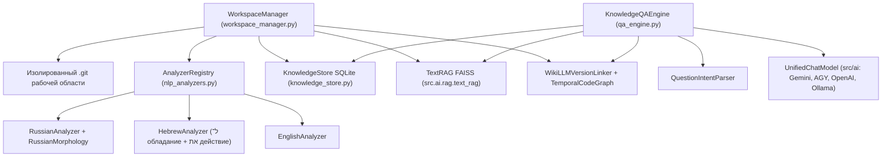

# ⚙️ Core — Ядро мультиязычного анализа, Git-версионирования, SQLite, FAISS и QA (`apps/ai_assistant/core`)

**Статус:** ✅ Активно  
**Версия:** 2.5.0  
**Пакет:** `apps.ai_assistant.core`  
**Автор:** hypo69  
**Updated:** 2026-10-26 00:26:00  

---

## 📋 Назначение пакета

Пакет `apps.ai_assistant.core` содержит бизнес-логику мультиязычной системы извлечения знаний, управления изолированными Git-репозиториями рабочих областей, реляционного хранения фактов в SQLite, семантического графа WikiLLM, векторного поиска FAISS и грамматического синтеза ответов на вопросы.

---

## 🏛️ Архитектура и взаимодействие компонентов



---

## 📦 Модули пакета

| Модуль / Подпакет | Основные классы | Описание |
|---|---|---|
| [`nlp/`](nlp/README.md) и [`nlp_analyzers.py`](nlp_analyzers.py) | `LanguageAnalyzer`, `AnalyzerRegistry`, `RussianMorphology`, `RussianAnalyzer`, `HebrewAnalyzer`, `EnglishAnalyzer`, `QuestionIntentParser` | Модульная подсистема мультиязычного NLP: посегментное определение языка (`ru`, `he`, `en`), межпредложенческое разрешение кореференции местоимений (`он/она/они/у него/у неё`, `הוא/היא/לו/לה`, `he/she/they`), извлечение фактов из Markdown-таблиц, склонение русских существительных по 6 падежам, разбор конструкций обладания в иврите (`ל־`) и прямого дополнения (`את`). |
| [`store/`](store/README.md) и [`knowledge_store.py`](knowledge_store.py) | `KnowledgeStore`, `WorkspaceRepoMixin`, `DocumentFactRepoMixin`, `TelemetryRepoMixin` | Модульное реляционное хранилище SQLite (режим `WAL`) с поддержкой полей `host_name` и `qualified_path` для носимого USB-режима и автоматическим переводом прежних фактов в статус `stale`. |
| [`workspace_registry.py`](workspace_registry.py) | `WorkspaceRegistry`, `get_current_host_name`, `parse_host_qualified_path`, `format_host_qualified_path` | Файловый реестр рабочих областей (`.workspace/config.json`) и утилиты привязки внешних путей к имени компьютера (`\\<HOST_NAME>\<PATH>`) при работе с флешки на разных ПК. |
| [`workspace_items_tracker.py`](workspace_items_tracker.py) | `WorkspaceItemsTracker` | Добавление файлов и директорий в Git-слежение (по умолчанию `copy_to_workspace=False` — без копирования, с хранением `\\<HOST_NAME>\<PATH>` в `.tracked_sources.json`), сводный просмотр локальных и внешних файлов и открытие в редакторе. |
| [`workspace_manager.py`](workspace_manager.py) | `WorkspaceManager` | Управление рабочими областями и изолированными `.git`-репозиториями, фиксация текстовых слепков внешних источников в `.extracted_snapshots/`, инкрементальное отслеживание изменений (`detect_changed_linked_sources`) и поддержка переноса между компьютерами (`other_host`). |
| [`rag_faiss_engine.py`](rag_faiss_engine.py) | `RagFaissEngine` | Гибридный векторно-лексический поисковый движок, объединяющий детерминированный индекс `TextRAG` (FAISS 256D) и лексическое совпадение токенов (TF). |
| [`qa_engine.py`](qa_engine.py) | `KnowledgeQAEngine` | Разбор вопроса через `QuestionIntentParser`, строгая фильтрация противоречий субъекта/объекта, учёт отрицания (`is_negated`) в открытых и закрытых вопросах, грамматический синтез ответа и обогащение через `src/ai` (`local_only`, `local_first`, `cloud_assist`, `cloud_enrich`). |
| [`git_history_engine.py`](git_history_engine.py) | `GitHistoryEngine` | Асинхронный адаптер чтения истории коммитов, диффов, blame и дерева файлов из репозитория Git. |
| [`temporal_code_graph.py`](temporal_code_graph.py) | `TemporalCodeGraph` | Темпоральный граф связей между файлами, коммитами и сущностями (`valid_from_commit`, `valid_to_commit`, `superseded_by`). |
| [`wikillm_version_linker.py`](wikillm_version_linker.py) | `WikiLLMVersionLinker` | Двухэтапная верификация и привязка знаний WikiLLM к коммитам Git с защитой от prompt-injection и утечки секретов. |
| [`query_orchestrator.py`](query_orchestrator.py) | `QueryOrchestrator` | Оркестратор параллельного поиска по истории версий Git, WikiLLM и RAG. |
| [`ai_diff_summarizer.py`](ai_diff_summarizer.py) | `AIDiffSummarizer` | Семантическое резюмирование изменений кода и текстовых диффов. |
| [`obsidian_vault.py`](obsidian_vault.py) | `ObsidianVaultBuilder` | Формирование компактного Obsidian Vault прямо внутри рабочей области (`workspaces/<id>/`): синхронизация «на лету» (YAML frontmatter + факты + `[[wikilinks]]` + `_Knowledge_Base.md`) и целенаправленная сборка тематических конспектов (`_Topics/<Тема>.md`). |
| [`engine_adapter.py`](engine_adapter.py) | `EngineRuntimeManager`, `ElectronEngineAdapter`, `WebView2EngineAdapter` | Единый контракт команд и событий для двух движков графической оболочки: **Electron** (основной: Chromium + Node.js + IPC) и **WebView2** (встроенный Windows GUI). |

---

## 💻 Примеры использования в коде

```python
from pathlib import Path
from apps.ai_assistant.core.workspace_manager import WorkspaceManager
from apps.ai_assistant.core.qa_engine import KnowledgeQAEngine

# 1. Инициализация менеджера рабочих областей и QA-движка
wm = WorkspaceManager(base_dir=Path("data/ai_assistant"))
qa = KnowledgeQAEngine(workspace_manager=wm)

# 2. Создание рабочей области с собственным Git-репозиторием
ws = wm.create_or_select_workspace("my_workspace", name="Моя рабочая область")

# 3. Импорт документов (автоматический git commit + NLP + SQLite + FAISS + WikiLLM)
wm.import_document("my_workspace", "mama.txt", "Мама мыла раму.")
wm.import_document("my_workspace", "farm.txt", "לדוד משה היתה חווה")

# 4. Выполнение вопросов к базе знаний
res_ru = await qa.ask("Кем была вымыта рама?", workspace_id="my_workspace", mode="local_only")
# res_ru["answer"] == "Мамой."

res_he = await qa.ask("למי הייתה חווה?", workspace_id="my_workspace", mode="local_only")
# res_he["answer"] == "לדוד משה"
```
