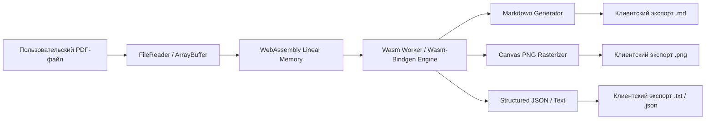

<!--
    Файл: apps/pdf_wasm_converter/README.md
    Назначение: Руководство по запуску и архитектуре браузерного конвертера PDF на Rust + WebAssembly
    Updated: 2026-10-27 21:17:00
-->

# ⚡ PDF Wasm Converter (Rust + WebAssembly в браузере)

Высокопроизводительный конвертер PDF-документов, выполняющийся **на 100% на стороне клиента** прямо в браузере. Данные не покидают устройство пользователя: парсинг, извлечение структуры, генерация Markdown, извлечение текста и растеризация страниц в PNG происходят в оперативной памяти с околонативной скоростью.

---

## 🚀 Быстрый старт (Без установки Rust)

Для немедленной работы с конвертером не требуется компилировать код или устанавливать инструментарий Rust:

1. Откройте файл [index.html](file:///c:/Users/onela/AppData/Local/AI-Assistant/apps/pdf_wasm_converter/index.html) в любом современном веб-браузере (Edge, Chrome, Firefox).
2. Перетащите в окно PDF-файл (или нажмите на область загрузки).
3. Документ будет обработан за несколько десятков миллисекунд.
4. Доступны вкладки:
   - **Markdown (.md)**: текст с автоопределением структуры заголовков (`H1`-`H3`), параграфов и списков.
   - **Текст (.txt)**: чистый текст с разбивкой по страницам.
   - **Изображения (PNG)**: растеризация страниц в высоком разрешении через HTML5 Canvas.
   - **JSON**: структура документа и метаданные.

---

## 🛠 Архитектура решения



### Преимущества технологии:
1. **Абсолютная конфиденциальность**: конфиденциальные документы (финансовые, юридические, персональные) никогда не отправляются на удаленный сервер.
2. **Мгновенная скорость**: нет сетевых задержек на передачу тяжелых файлов по HTTP/HTTPS.
3. **Экономия ресурсов**: нулевая нагрузка на серверную инфраструктуру.

---

## 🦀 Сборка собственного Wasm-модуля на Rust

В папке `rust_engine` подготовлен шаблон крейта на Rust:

### Требования:
- Rust 1.75+ (`rustup target add wasm32-unknown-unknown`)
- `wasm-pack` (`cargo install wasm-pack`)

### Команда сборки:
```powershell
cd apps/pdf_wasm_converter/rust_engine
wasm-pack build --target web --release
```

После завершения сборки папка `pkg/` будет содержать `.wasm` бинарник и JS-обертку, готовую для прямого импорта через `import init, { convert_pdf_bytes } from './pkg/pdf_wasm_engine.js';`.
