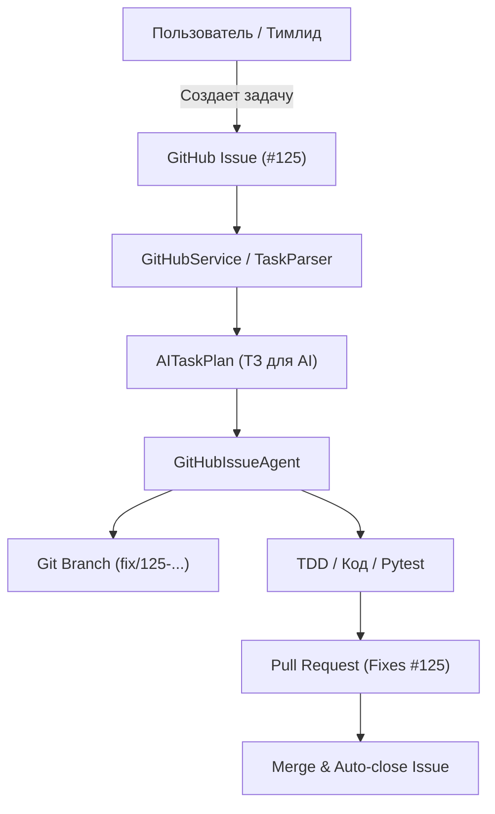

# 🐙 Модуль управления GitHub Issues & Projects (AI-TC)

**Updated:** 2026-11-01 13:48:00  
**Автор:** hypo69  
**Пакет:** `src.github`

## 🎯 Назначение

Модуль `src.github` реализует программное управление задачами, вехами и жизненным циклом проекта непосредственно через GitHub Issues и GitHub Projects. Он служит фундаментом для концепции **Issue-driven AI Development**, превращая GitHub Issues в централизованное Task API и структурированное техническое задание (ТЗ) для автономных AI-разработчиков.

---

## 🏛️ Архитектура модуля



### Основные компоненты:
1. **`models.py`** — Типизированные перечисления (`IssueType`, `Priority`, `Component`, `ProjectColumn`, `IssueState`) и классы данных (`Issue`, `Milestone`, `AITaskPlan`).
2. **`client.py`** — Отказоустойчивый клиент для вызова GitHub CLI (`gh`) с обработкой таймаутов, авторизации и структурированным выводом JSON.
3. **`task_parser.py`** — Синтаксический анализатор Markdown-описания Issue, автоматическое извлечение затронутых файлов, шагов воспроизведения, критериев приёмки, генерация веток Git (`fix/125-...`) и тел Pull Request (`Fixes #125`).
4. **`service.py`** — Высокоуровневый фасад для манипуляции задачами, синхронизации стандартных меток и переключения веток.

---

## 🏷️ Система меток (Labels)

| Категория | Метки | Значение |
|---|---|---|
| **Тип задачи** | `bug`, `feature`, `enhancement`, `documentation`, `refactoring`, `research` | Категория изменения |
| **Приоритет** | `priority:critical`, `priority:high`, `priority:medium`, `priority:low` | Срочность и влияние |
| **Компонент** | `component:telemetry`, `component:network`, `component:windows`, `component:gui`, `component:ai`, `component:mcp`, `component:core` | Подсистема кодовой базы AI-TC |

---

## 💻 Примеры использования (Python API)

```python
from src.github import GitHubService, IssueType, Priority, Component

service = GitHubService()

# 1. Получение открытых задач
issues = service.get_issues(state='open')
for issue in issues:
    print(f"#{issue.number} [{issue.priority.name}] {issue.title}")

# 2. Создание новой задачи
new_issue = service.create_issue(
    title="Оптимизировать сбор метрик CPU",
    body="Необходимо уменьшить частоту опроса в спящем режиме.",
    issue_type=IssueType.ENHANCEMENT,
    priority=Priority.MEDIUM,
    component=Component.TELEMETRY
)

# 3. Формирование ТЗ для AI-агента
plan = service.create_task_plan(issue_number=125)
print(f"Рекомендуемая ветка: {plan.suggested_branch}")
print(f"Файлы под изменение: {plan.target_files}")
```
